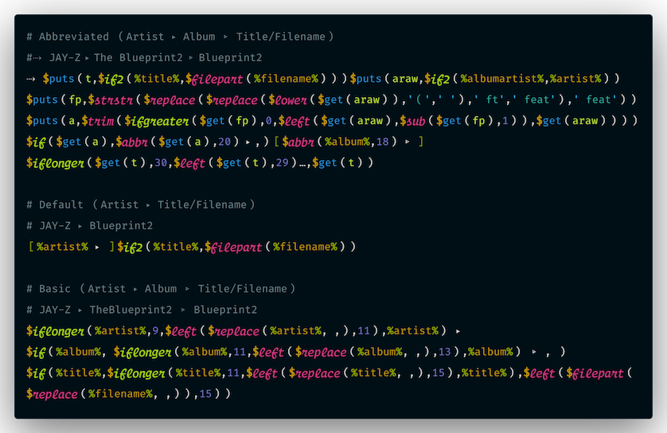

# ATF — Advanced Title Formatting for VS Code

Language support for **WACUP / Winamp Advanced Title Formatting** (ATF, a.k.a. *tagz*): the format strings behind playlist titles, the song ticker and the taskbar text, such as

<!-- GitHub has no ATF grammar; coffeescript is the closest: it colours $calls as functions, the % of fields, numbers, 'literals' and # comments. -->
```coffeescript
[%artist% ▸ ]$if2(%title%,$filepart(%filename%))
```

ATF is hard to debug inside the player. One stray character turns every title in the playlist into `[SYNTAX ERROR IN FORMATTING STRING (4)]` and gives no hint where it is. This extension's parser behaves like WACUP's, so it reports the same errors *and* points at the cause.



## Features

- **Highlighting**: fields, functions (control flow, variables and the rest are coloured separately), `'literals'`, the `%% $$ ''` escapes, `[conditional]` sections and integer arguments. Bare `(` `)` `]` are marked invalid.
- **WACUP-accurate errors**: the same error codes as WACUP, plus the culprit, e.g. *no balanced ')' for $puts( — unclosed '[' at column 61*.
- **14 lint rules**: unknown and removed functions, argument counts, empty numeric arguments, always-true/always-false `$if` conditions, `$get` before `$puts`, unknown fields, `[…]` with no field. Each rule's severity is configurable.
- **Hovers and completion**: signatures and docs after `$`, the field list after `%`. They cover the documented functions and the undocumented WACUP extras (`$strbetween`, `$padout`, `$is_stream`, `$leftbracket()`…).
- **Lossless formatting**: wraps long formats onto several lines without changing their output.
- **Copy Format as Single Line**: puts the format at the cursor on the clipboard as one line, ready to paste into WACUP's preferences box.
- **Two dialects**: WACUP 1.99.x (default) and classic Winamp 5.

## `.atf` files

ATF itself has no comments or line breaks, so `.atf` files use a simple convention:

- a `#` in column 0 starts a comment line;
- a blank line separates formats;
- consecutive lines are **joined with nothing in between** into one format.

So you can keep a library of formats, with long ones split up for reading. This is `samples/winamp-playlist-titles.atf`, the file in the screenshot:

```coffeescript
# Abbreviated (Artist ▸ Album ▹ Title/Filename)
#⇢  JAY-Z ▸ The Blueprint2 ▹ Blueprint2
⇢  $puts(t,$if2(%title%,$filepart(%filename%)))$puts(araw,$if2(%albumartist%,%artist%))
$puts(fp,$strstr($replace($replace($lower($get(araw)),'(',' '),' ft',' feat'),' feat'))
$puts(a,$trim($ifgreater($get(fp),0,$left($get(araw),$sub($get(fp),1)),$get(araw))))
$if($get(a),$abbr($get(a),20) ▸ ,)[$abbr(%album%,18) ▹ ]
$iflonger($get(t),30,$left($get(t),29)…,$get(t))

# Default (Artist ▸ Title/Filename)
# JAY-Z ▸ Blueprint2
[%artist% ▸ ]$if2(%title%,$filepart(%filename%))

# Basic (Artist ▸ Album ▹ Title/Filename)
# JAY-Z ▸ TheBlueprint2 ▹ Blueprint2
$iflonger(%artist%,9,$left($replace(%artist%, ,),11),%artist%) ▸
$if(%album%, $iflonger(%album%,11,$left($replace(%album%, ,),13),%album%) ▹ , )
$if(%title%,$iflonger(%title%,11,$left($replace(%title%, ,),15),%title%),$left($filepart($replace(%filename%, ,)),15))
```

Each block is one format string; the comment under each heading shows what it outputs. Hover anything for docs, then use **ATF: Copy Format as Single Line** (editor context menu or Command Palette) to paste it into WACUP.

To use the language for files with other names:

```jsonc
"files.associations": { "*-atf.pl": "atf" }
```

## Formatting

In ATF every space is output, so there's no indenting or re-spacing. **Format Document** only changes *where a block is split into lines*: it breaks between top-level constructs (`$calls`, `[sections]`, `%fields%`, `'literals'` and text runs) to fit `atf.format.lineWidth`, like the first block above. A break is never made:

- next to a space, because editors trim trailing whitespace on save;
- where the next line would start with `#` and become a comment;
- in a block with a syntax error, which is left exactly as written.

The tests check that joining the formatted lines gives back the original string, for the sample file and thousands of random formats, and that formatting twice changes nothing. `"atf.format.lineWidth": 0` joins every block onto one line.

## Error codes

These are the numbers WACUP prints in `[SYNTAX ERROR IN FORMATTING STRING (n)]`. Neither WACUP nor Winamp documents them; this table describes what WACUP 1.99.43 reports.

| Code | Meaning | Typical cause |
|---|---|---|
| 2 | `%` with no closing `%` (WACUP shows `[TRUNCATED FORMATTING STRING…]`) | `%artist - ` |
| 3 | `$name` with no `(` | `$if2` at the end of the string |
| 4 | `$name(` with no balanced `)` | a missing `)`, or a stray `[` or `'` inside the call |
| 6 | an argument with an unbalanced `(`/`[`/quote | |
| 7 | `'` with no closing `'` | `'abc` |
| 8 | `[` with no balanced `]` | `[%album% - ` |
| 9 | bare `]`, `(` or `)` in text | `feat)`: write `')'` or `$rightbracket()` |

A syntax error replaces the **whole** title. Unknown functions (`[UNKNOWN FUNCTION -> $x]`) and wrong argument counts (`[INVALID $if() SYNTAX]`) only replace the call itself.

## Lint rules

| Rule | Default | What it catches |
|---|---|---|
| `syntax` | error | A syntax error (table above). |
| `unknown-function` | error | Function not in WACUP's function table. |
| `removed-function` | error | Documented but not callable: `$and`, `$greater`, `$fill`. |
| `dialect-function` | error | Function that only exists in the other dialect. |
| `arity-strict` | error | Wrong argument count for `$if`, `$if2`, `$ifgreater`, `$iflonger`, `$IfStrEqual*`. |
| `arity-min` / `arity-max` | warning | Too few / too many arguments; the function silently outputs nothing. |
| `too-many-args` | warning | More than 16 arguments; WACUP ignores the rest. |
| `empty-number` | warning | Empty numeric argument such as `$left(%artist%,)`, which counts as 0. |
| `always-true-condition` | warning | WACUP: `$if($strstr(…),…)` and similar always take the first branch (`$strstr` returns `"0"`, not empty). |
| `always-false-condition` | warning | Winamp 5: a condition with no `%field%` always takes the else branch. |
| `get-before-put` | warning | `$get(x)` before any `$puts`/`$put` sets `x`. |
| `unknown-field` | hint | Field not known to WACUP; input plugins may still provide it. |
| `cond-without-field` | hint | `[…]` containing no `%field%`, so it never shows. |

## Settings

| Setting | Default | |
|---|---|---|
| `atf.dialect` | `wacup` | `wacup` (1.99.x: `$if` tests for a non-empty string; extra functions) or `winamp` (classic 5.x: `$if` tests for resolved fields). |
| `atf.lint.enable` | `true` | Turn diagnostics off; everything else keeps working. |
| `atf.lint.rules` | `{}` | Per-rule severity: `"error"`, `"warning"`, `"info"`, `"hint"` or `"off"`, e.g. `{ "unknown-field": "off" }`. |
| `atf.format.lineWidth` | `100` | Wrap width for Format Document; `0` joins each block onto one line. |

## Colours

The grammar uses standard TextMate scopes, so every theme colours it. To fine-tune, these are the ATF-specific scopes:

| Token | Scope |
|---|---|
| `$` of a call | `punctuation.definition.function.atf` |
| `$if` `$if2` `$iflonger` `$decode` `$select`… | `keyword.control.conditional.atf` |
| `$puts` `$put` `$get` / variable name | `storage.type.variable.atf` / `variable.other.readwrite.atf` |
| other functions | `entity.name.function.atf` |
| `%field%` / its `%` | `variable.other.field.atf` / `punctuation.definition.variable.atf` |
| `'literal'` | `string.quoted.single.atf` |
| `%%` `$$` `''` | `constant.character.escape.atf` |
| `[` `]` | `keyword.other.conditional.atf` |
| integer argument | `constant.numeric.integer.atf` |

For example, a gold `$` sigil:

```jsonc
"editor.tokenColorCustomizations": {
  "textMateRules": [
    { "scope": "punctuation.definition.function.atf", "settings": { "foreground": "#be9208", "fontStyle": "bold" } }
  ]
}
```

**Material Icon Theme** doesn't use icons that extensions contribute for their languages. To get the ATF file icon there, put `images/atf-dark.svg` in your `.vscode/extensions/icons/` folder as `atf.svg`, then add:

```jsonc
"material-icon-theme.files.associations": { "*.atf": "../../icons/atf" }
```

Material caches a copy as `atf~<hash>.svg`; if you later change the SVG, toggle any Material setting so it copies it again.

## Performance

The parser follows WACUP's algorithm: one pass, where each call re-scans its own extent. Measured on Node 26:

| Input | Lint time |
|---|---|
| a typical 365-character format | ~45 µs |
| a 2 KB `.atf` file | ~0.2 ms |
| a 4.5 MB file (56,000 lines) | ~0.5 s |
| one 1 MB format string | ~80 ms |
| nesting 1,000 levels deep (real formats nest under 10) | ~40 ms |

Diagnostics are debounced while typing, and each document version is parsed once and shared by diagnostics, hovers and the copy command.

## Known limitations

- The linter checks structure, not output. It doesn't evaluate formats, so it can't catch logic errors like a wrong `$left` length.
- Several WACUP extras (`$rating`, `$bitdepth`, `$select`, `$split`, `$pathsafe`) are undocumented; their hovers say what is known.
- The `%length%` unit depends on where the format is used (`m:ss` in the WACUP playlist, milliseconds in Winamp 5 and WACUP's taskbar text).
- WACUP shows error 1 for an empty global format; empty `.atf` blocks don't exist, so this is never reported.

## Development

```sh
npm install
npm test            # TypeScript build + node --test (parser, linter, formatter, settings schema)
npm run package     # → atf-syntax-<version>.vsix
code --install-extension atf-syntax-<version>.vsix
```

**F5** opens an Extension Development Host on `samples/`.

## Releases

Publishing a GitHub release runs `.github/workflows/publish.yml`. It tests and packages the extension, attests the build provenance of the `.vsix`, attaches that exact file to the release, and publishes it to the Visual Studio Marketplace with trusted publishing (OIDC, no tokens). Tags and commits are GPG-signed, and each release `.vsix` also has a detached GPG signature (`.asc`). To verify a download:

```sh
gh attestation verify atf-syntax-<version>.vsix --repo GhostPirateBob/atf-syntax
gpg --verify atf-syntax-<version>.vsix.asc atf-syntax-<version>.vsix
```

The extension has no runtime dependencies beyond VS Code itself. See `THIRD_PARTY_NOTICES.md` for the icon attribution.

## Disclaimer

This is an independent project. It is not affiliated with, endorsed by or sponsored by WACUP or Winamp. WACUP and Winamp are trademarks of their respective owners and are named here only to describe compatibility.
