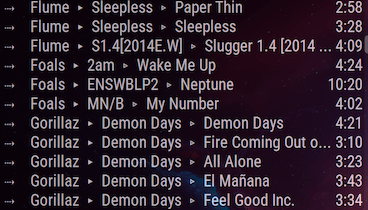
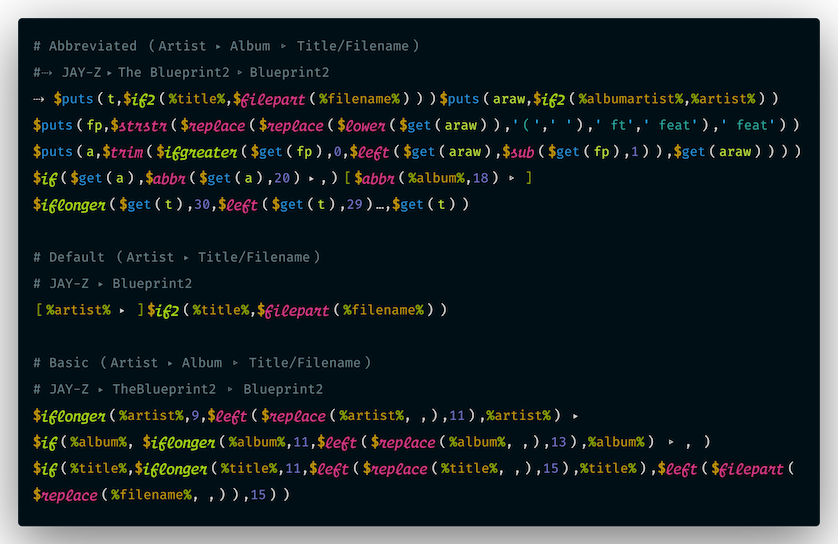

# ATF — Advanced Title Formatting for VS Code

Language support for **WACUP / Winamp Advanced Title Formatting** (ATF, a.k.a. *tagz*): the format strings behind playlist titles, the song ticker and the taskbar text, such as

<!-- GitHub has no ATF grammar. Fences use lua, the best match across GitHub, VS Code and other renderers, but # isn't a comment in lua and -- starts one, so keep both out of these blocks. -->
```lua
[%artist% ▸ ]$if2(%title%,$filepart(%filename%))
```

**Try formats live in the [ATF playground](https://ghostpiratebob.me/atf-syntax/)**: type a format and see it render for sample tracks or your own playlist, with the same checking as this extension. Every function, field, rule and setting is on the [extension docs page](https://ghostpiratebob.me/atf-syntax/extension/).



*The Abbreviated format from [the sample file](#atf-files), running in WACUP's playlist.*

ATF is hard to debug inside the player. One stray character turns every title in the playlist into `[SYNTAX ERROR IN FORMATTING STRING (4)]` and gives no hint where it is. This extension's parser behaves like WACUP's, so it reports the same errors *and* points at the cause.



## Install

From the [Visual Studio Marketplace](https://marketplace.visualstudio.com/items?itemName=gpb.atf-syntax), or:

```sh
code --install-extension gpb.atf-syntax
```

## Features

- **Highlighting**: fields, functions (control flow, variables and the rest are coloured separately), `'literals'`, the `%% $$ ''` escapes, `[conditional]` sections and integer arguments. Bare `(` `)` `]` are marked invalid.
- **WACUP-accurate errors**: the same error codes as WACUP, plus the culprit, e.g. *no balanced ')' for $puts( — unclosed '[' at column 61*. WACUP shows a syntax error in place of the scope it's in: the whole title at the top level, otherwise just that function argument or `[…]` section. [All error codes](https://github.com/GhostPirateBob/atf-syntax/wiki/Error-Codes).
- **20 lint rules**: formats that freeze WACUP or crash Winamp 5, unknown and removed functions, names too long for WACUP 1.99.57, argument counts, empty numeric arguments, always-true/always-false `$if` conditions (`$if($strstr(%title%,live),…)` only tests that `%title%` isn't empty), `$get` before `$puts`, unknown fields, `[…]` with no field. Each rule's severity is configurable. [All rules](https://github.com/GhostPirateBob/atf-syntax/wiki/Lint-Rules).
- **Hovers and completion**: signatures and docs after `$`, the field list after `%`. They cover the documented functions and the undocumented WACUP extras (`$strbetween`, `$padout`, `$is_stream`, `$leftbracket()`…), and say where Winamp 5 differs or crashes.
- **Lossless formatting**: wraps long formats onto several lines without changing their output. [How it works](https://github.com/GhostPirateBob/atf-syntax/wiki/Formatting).
- **Copy Format as Single Line**: puts the format at the cursor on the clipboard as one line, ready to paste into WACUP's preferences box. It warns if the format freezes WACUP, or under the `winamp` dialect, if it crashes or freezes Winamp 5.
- **Two dialects**: WACUP 1.99.x (default) and classic Winamp 5. [How they differ](https://github.com/GhostPirateBob/atf-syntax/wiki/Winamp-5-vs-WACUP).

**Some formats freeze WACUP**, like an empty search in `$replace` or a negative count in `$tab`, and **some crash Winamp 5**, like an empty `$trim()`. The linter marks these as errors, and [the wiki explains why](https://github.com/GhostPirateBob/atf-syntax/wiki/Formats-That-Freeze-WACUP).

## `.atf` files

ATF itself has no comments or line breaks, so `.atf` files use a simple convention:

- a `#` in column 0 starts a comment line;
- a blank line separates formats;
- consecutive lines are **joined with nothing in between** into one format.

So you can keep a library of formats, with long ones split up for reading. These are the three formats in `samples/winamp-playlist-titles.atf`, the file in the screenshot. In the file, the name and example output above each one are `#` comments.

### Abbreviated (Artist ▸ Album ▹ Title/Filename)

`⇢  JAY-Z ▸ The Blueprint2 ▹ Blueprint2`

```lua
⇢  $puts(t,$if2(%title%,$filepart(%filename%)))$puts(araw,$if2(%albumartist%,%artist%))
$puts(fp,$strstr($replace($replace($lower($get(araw)),'(',' '),' ft',' feat'),' feat'))
$puts(a,$trim($ifgreater($get(fp),0,$left($get(araw),$sub($get(fp),1)),$get(araw))))
$if($get(a),$abbr($get(a),20) ▸ ,)[$abbr(%album%,18) ▹ ]
$iflonger($get(t),30,$left($get(t),29)…,$get(t))
```

### Default (Artist ▸ Title/Filename)

`JAY-Z ▸ Blueprint2`

```lua
[%artist% ▸ ]$if2(%title%,$filepart(%filename%))
```

### Basic (Artist ▸ Album ▹ Title/Filename)

`JAY-Z ▸ TheBlueprint2 ▹ Blueprint2`

```lua
$iflonger(%artist%,9,$left($replace(%artist%, ,),11),%artist%) ▸
$if(%album%, $iflonger(%album%,11,$left($replace(%album%, ,),13),%album%) ▹ , )
$if(%title%,$iflonger(%title%,11,$left($replace(%title%, ,),15),%title%),$left($filepart($replace(%filename%, ,)),15))
```

Each block is one format string. Hover anything for docs, then use **ATF: Copy Format as Single Line** (editor context menu or Command Palette) to paste it into WACUP.

To use the language for files with other names:

```jsonc
"files.associations": { "*-atf.pl": "atf" }
```

## Settings

| Setting | Default | |
|---|---|---|
| `atf.dialect` | `wacup` | `wacup` (1.99.x: `$if` tests for a non-empty string; extra functions) or `winamp` (classic 5.x: `$if` tests for resolved fields). |
| `atf.lint.enable` | `true` | Turn diagnostics off; everything else keeps working. |
| `atf.lint.rules` | `{}` | Per-rule severity: `"error"`, `"warning"`, `"info"`, `"hint"` or `"off"`, e.g. `{ "unknown-field": "off" }`. |
| `atf.format.lineWidth` | `100` | Wrap width for Format Document; `0` joins each block onto one line. |

## Known limitations

- The linter checks structure, not output. It doesn't evaluate formats, so it can't catch logic errors like a wrong `$left` length. To see what a format outputs, try it in the [playground](https://ghostpiratebob.me/atf-syntax/).
- The `%length%` unit depends on where the format is used (`m:ss` in the WACUP playlist, milliseconds in Winamp 5 and WACUP's taskbar text).
- Hovers and argument rules were checked by running formats through the real engines: WACUP 1.99.43.23234 and 1.99.57.25464, and Winamp 5.666 and 5.9.2. The exceptions are `$rating` and `$bitdepth`, which need a running WACUP, so theirs come from reading its code. The build where a change first appeared (such as 1.99.55.25130 for `$cut` with a negative n) comes from WACUP's changelog and its developer.

## More

The [wiki](https://github.com/GhostPirateBob/atf-syntax/wiki) has the technical detail, including [token colours](https://github.com/GhostPirateBob/atf-syntax/wiki/Colours), [performance](https://github.com/GhostPirateBob/atf-syntax/wiki/Performance) and [building from source](https://github.com/GhostPirateBob/atf-syntax/wiki/Development).

The extension has no runtime dependencies beyond VS Code itself. See `THIRD_PARTY_NOTICES.md` for the icon attribution.

## Disclaimer

This is an independent project. It is not affiliated with, endorsed by or sponsored by WACUP or Winamp. WACUP and Winamp are trademarks of their respective owners and are named here only to describe compatibility.
